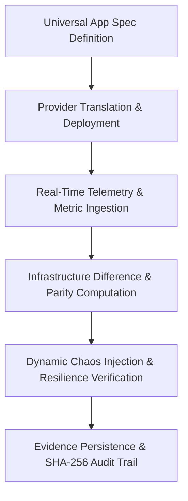

# CLOUD-223 — Application Platform Abstraction Over Heterogeneous Cloud Infrastructure

> **KL University • Engineering Capstone Project**  
> **Canonical ID**: CLOUD-223  
> **Technical Domain**: Cloud, Edge & DevOps Engineering  
> **Dominant Specialization**: Cloud Infrastructure Design & Engineering  
> **Reference Source**: [Cloud Foundry — Korifi](https://github.com/cloudfoundry/korifi)  
> **Candidate**: Shaik Mohammed Sameer (Reg. No: 2300031607)

---

## 📋 Table of Contents

1. [Project Overview & Core Thesis](#project-overview--core-thesis)
2. [System Architecture](#system-architecture)
3. [How the Platform Works (End-to-End Workflow)](#how-the-platform-works-end-to-end-workflow)
4. [Deep-Dive: Key Capabilities & Examples](#deep-dive-key-capabilities--examples)
   - [1. Dynamic, Randomized Workloads & Chaos Campaigns](#1-dynamic-randomized-workloads--chaos-campaigns)
   - [2. Multi-Cluster Kubernetes Orchestration](#2-multi-cluster-kubernetes-orchestration)
   - [3. Broader Provider Parity Coverage (10 Dimensions)](#3-broader-provider-parity-coverage-10-dimensions)
   - [4. Extended Fault Types in ChaosEngine (12 Types)](#4-extended-fault-types-in-chaosengine-12-types)
5. [Universal Application Specification Example](#universal-application-specification-example)
6. [API Reference & cURL Examples](#api-reference--curl-examples)
7. [Governance & Gate G0 Compliance](#governance--gate-g0-compliance)
8. [Testing & Operational Procedures](#testing--operational-procedures)
9. [Project Directory Layout](#project-directory-layout)
10. [Quickstart & Local Setup](#quickstart--local-setup)

---

## Project Overview & Core Thesis

Enterprise cloud strategy routinely places a high-level application platform abstraction over heterogeneous cloud infrastructure so developers can deploy applications without confronting low-level cloud provider nuances. 

In practice, these abstractions **leak underlying infrastructure differences** where they matter most:
- **Storage IOPS Budgets**: SSD vs Premium Disk vs Persistent Disk throughput differences bottleneck database tiers.
- **Network Latency & Policy Semantics**: Security Groups vs Network Security Groups vs VPC firewall connection tracking.
- **Compute Cold-Start Timing**: Firecracker microVMs vs Hyper-V containers vs gVisor sandboxing profiles.
- **Cost & Resource Asymmetry**: Divergent egress rates, memory accounting, and CPU quota throttling.

This project delivers a production-grade **Application Platform Abstraction Layer** with empirical leakage detection, multi-cloud federation, and automated resilience verification across **Azure**, **AWS**, **GCP**, and **Multi-Cluster Kubernetes**.

---

## System Architecture

```
┌────────────────────────────────────────────────────────────────────────────────────────┐
│                                React 19 + Vite Frontend                                │
│   (Unified Multi-Cloud Dashboard, Deployment Wizard, Parity Matrix, Chaos Studio, SOC) │
└───────────────────────────────────────────┬────────────────────────────────────────────┘
                                            │ HTTPS REST / WebSocket (WSS)
┌───────────────────────────────────────────▼────────────────────────────────────────────┐
│                                Express.js Core Backend                                 │
│        Tenant Isolation │ JWT / MSAL Auth │ RBAC Middleware │ SHA-256 Audit Trail      │
├───────────────────┬───────────────────┬───────────────────┬────────────────────────────┤
│ Application       │ Deployment        │ Infrastructure    │ Multi-Cluster              │
│ Catalog Service   │ Dispatch Engine   │ Difference Engine │ Kubernetes Service         │
│ (Universal Spec)  │ (IDeploymentProv) │ (10 Dimensions)   │ (AKS / EKS / GKE Registry) │
├───────────────────┼───────────────────┼───────────────────┼────────────────────────────┤
│ Telemetry &       │ Chaos & Fault     │ DR & Recovery     │ Evidence Persistence       │
│ OpenTelemetry SDK │ Engine (12 Types) │ Engine            │ (SHA-256 Manifest Writer)  │
└───────────────────┴─────────┬─────────┴───────────────────┴────────────────────────────┘
                              │
          ┌───────────────────┼───────────────────┬───────────────────┐
          │                   │                   │                   │
    ┌─────▼─────┐       ┌─────▼─────┐       ┌─────▼─────┐       ┌─────▼─────┐
    │   Azure   │       │    AWS    │       │    GCP    │       │Kubernetes │
    │  Adapter  │       │  Adapter  │       │  Adapter  │       │Federation │
    └─────┬─────┘       └─────┬─────┘       └─────┬─────┘       └─────┬─────┘
          │                   │                   │                   │
    ┌─────▼─────┐       ┌─────▼─────┐       ┌─────▼─────┐       ┌─────▼─────┐
    │ Container │       │ ECS / EKS │       │ Cloud Run │       │ AKS / EKS │
    │ Apps / AKS│       │  Fargate  │       │    GKE    │       │ GKE Nodes │
    └───────────┘       └───────────┘       └───────────┘       └───────────┘
```

---

## How the Platform Works (End-to-End Workflow)

The platform operates through a 5-stage automated pipeline:



### Stage 1: Universal Application Specification
Developers define a cloud-agnostic application descriptor declaring compute limits, container image, environment variables, port mappings, scaling rules, and health checks.

### Stage 2: Provider Translation & Automated Provisioning
The `ProviderFactory` translates the universal spec into provider-specific orchestrations:
- **Azure**: Provisions Azure Container Apps / AKS manifests via Azure ARM SDK.
- **AWS**: Generates CloudFormation templates targeting ECS Fargate or EKS.
- **GCP**: Configures Cloud Run services or GKE deployments via Google Cloud SDK.
- **Kubernetes**: Directly applies Deployments, Services, and Namespaces across registered multi-cluster topologies.

### Stage 3: Telemetry Collection & Normalization
The runtime captures CPU utilization, memory allocation, network latency, disk I/O throughput, container cold-start delay, cost metrics, and uptime logs across all deployed targets.

### Stage 4: Difference Detection & Parity Scoring
The `InfraDiffEngine` and `ComparisonEngine` compare the exact same workload across clouds:
- Calculates percentage spread per dimension.
- Runs ablation analysis (impact of isolating single signals).
- Evaluates the **KPI-3 Parity Score** (batch equivalence within ±10% tolerance).

### Stage 5: Chaos Verification & Evidence Generation
The `ChaosEngine` injects real or simulated perturbations (e.g., killed pods, latency, memory stress, DNS drop) to verify failover, writes structured JSON records, and seals evidence into `evidence/manifest.json`.

---

## Deep-Dive: Key Capabilities & Examples

### 1. Dynamic, Randomized Workloads & Chaos Campaigns

Rather than testing only predictable, static failures, the platform supports **dynamic, randomized workload perturbation** that mirrors real-world cloud failures.

#### How It Works:
- **`runRandomizedWorkload()`**: Selects a randomized fault from the 12-type registry, applies randomized intensity levels (1–3), and injects pre-experiment timing jitter (0–2000ms) to ensure non-deterministic arrival times.
- **`runCampaign()`**: Orchestrates an automated multi-round fault campaign (sequential or parallel) across targets, measures recovery time (RTO), and generates an aggregated resilience score.

#### Example: Triggering a Randomized Chaos Campaign
```http
POST /api/chaos/campaign
Content-Type: application/json
Authorization: Bearer <JWT_TOKEN>

{
  "targetResource": "prod-payment-api",
  "rounds": 5,
  "intervalMs": 1500,
  "sequential": true,
  "excludeTypes": []
}
```

#### Example Response:
```json
{
  "campaignId": "campaign-1771401234-8921",
  "targetResource": "prod-payment-api",
  "totalRounds": 5,
  "passed": 5,
  "failed": 0,
  "successRate": 100,
  "faultTypesExercised": [
    "MEMORY_PRESSURE",
    "NETWORK_LATENCY",
    "DNS_FAILURE",
    "KILL_POD",
    "DISK_IO_STRESS"
  ],
  "faultTypeCoverage": "5/12",
  "executionMode": "SEQUENTIAL",
  "campaignDurationSec": 8.42,
  "evidenceRunId": "run-chaos-1771401234.json"
}
```

---

### 2. Multi-Cluster Kubernetes Orchestration

The platform provides a centralized Kubernetes control plane that unifies multi-cloud Kubernetes clusters (**AKS**, **EKS**, **GKE**, and on-premise clusters) under a single management interface.

#### Key Features:
- **Dynamic Cluster Registry**: Persistent storage (`k8s_clusters` table) for tracking cluster endpoints, cloud regions, and provider types.
- **Context-Aware API Clients**: Dynamic switching between Kubeconfig contexts per cluster.
- **Federated Workload Aggregation**: Single API call retrieves all pods, deployments, services, and node health across all connected clusters.
- **Targeted Workload Deployment**: Deploy to a specific cluster or orchestrate multi-cluster replicas.

#### Example: Registering an AKS Cluster
```http
POST /api/kubernetes/clusters
Content-Type: application/json
Authorization: Bearer <JWT_TOKEN>

{
  "name": "production-aks-eastus",
  "provider": "aks",
  "region": "eastus",
  "contextName": "aks-prod-eastus-admin",
  "endpoint": "https://aks-prod-eastus-dns-1234.hcp.eastus.azmk8s.io:443"
}
```

#### Example: Fetching Multi-Cluster Summary
```http
GET /api/kubernetes/multi-cluster/summary
Authorization: Bearer <JWT_TOKEN>
```
```json
{
  "multiCluster": true,
  "totalClusters": 3,
  "aggregated": {
    "totalNodes": 18,
    "totalPods": 74,
    "totalDeployments": 22,
    "totalServices": 19,
    "healthyNodes": 18,
    "unhealthyNodes": 0
  },
  "providerBreakdown": {
    "aks": 1,
    "eks": 1,
    "gke": 1,
    "generic": 0
  }
}
```

---

### 3. Broader Provider Parity Coverage (10 Dimensions)

The platform evaluates cross-cloud infrastructure leakage across **10 distinct dimensions** (expanded from the original 5 compute/storage/network metrics).

| Dimension | Category | Metric Column | Unit | Leakage Impact Rationale |
|-----------|----------|---------------|------|--------------------------|
| **1. Storage Throughput** | Storage | `avg_storage` | MB/s | Disk SKU IOPS ceilings bottleneck database tiers |
| **2. Network Latency** | Network | `avg_latency` | ms | NSG vs Security Group connection tracking latency |
| **3. Cold-Start Timing** | Compute | `avg_startup` | s | MicroVM hypervisor provisioning delay on scale-from-zero |
| **4. Memory Efficiency** | Resource | `avg_memory` | MB | Hypervisor memory overhead and host accounting |
| **5. CPU Scheduling** | Compute | `avg_cpu` | % | Hypervisor vCPU throttling profiles under load |
| **6. Cost Efficiency** | FinOps | `avg_cost_per_hour` | $/hr | Asymmetric compute pricing & egress cost variations |
| **7. Security Posture** | Security | `avg_security_score` | 0-100 | Default firewall, IAM granularity, and encryption policy drift |
| **8. Compliance Adherence** | Governance | `avg_compliance_score` | 0-100 | Built-in framework support (SOC2, HIPAA, PCI-DSS) |
| **9. Availability / Uptime** | Reliability | `avg_uptime_pct` | % | SLA commitments and historical node stability variance |
| **10. Auto-Scaling Latency** | Performance | `avg_scale_latency_sec` | s | Time from trigger to running container ready status |

#### Example: Parity Matrix API Query
```http
GET /api/infrastructure-difference/parity-matrix
Authorization: Bearer <JWT_TOKEN>
```
```json
{
  "totalDimensions": 10,
  "measuredDimensions": 5,
  "gapDimensions": 5,
  "coveragePercent": 50,
  "dimensions": [
    {
      "category": "Storage IOPS & Throughput",
      "status": "MEASURED",
      "measured": 3,
      "totalProviders": 3,
      "providerValues": { "azure": "240.5 MB/s", "aws": "310.2 MB/s", "gcp": "195.0 MB/s" },
      "leakageImpact": "Observed spread across 3 provider(s): 59.1% (measured, n=42)"
    }
  ]
}
```

---

### 4. Extended Fault Types in ChaosEngine (12 Types)

The `ChaosEngine` implements 12 fault types following a **real-perturbation-first, structured-simulation-fallback** architecture:

```
                  ┌───────────────────────────────┐
                  │ Chaos Experiment Requested    │
                  └───────────────┬───────────────┘
                                  │
                  ┌───────────────▼───────────────┐
                  │ Can execute real command?     │
                  │ (Docker / kubectl / iptables) │
                  └───────┬───────────────┬───────┘
                          │ YES           │ NO
             ┌────────────▼──────┐  ┌─────▼─────────────┐
             │ Real Perturbation │  │ Time/Process-Level│
             │ (High Fidelity)   │  │ Simulation Fallback│
             └────────────┬──────┘  └─────┬─────────────┘
                          │               │
                  ┌───────▼───────────────▼───────┐
                  │  EvidenceWriter Persistence   │
                  │  (SHA-256 Checksum Manifest)  │
                  └───────────────────────────────┘
```

| Fault Type | Category | Severity | Real Injection Mechanism | Simulation Fallback Method |
|------------|----------|----------|--------------------------|----------------------------|
| `KILL_POD` | Compute | High | `docker kill <id>` / `kubectl delete pod` | Timed process interruption delay |
| `NODE_RESTART` | Compute | Critical | `kubectl drain + uncordon` | Simulated node reboot delay |
| `CPU_STRESS` | Resource | Medium | `docker exec yes > /dev/null` | In-process intensive computation burn |
| `NETWORK_LATENCY` | Network | Medium | `tc qdisc add dev eth0 root netem delay` | `Promise.setTimeout` proxy delay |
| `STORAGE_DISCONNECT`| Storage | High | `mount -o remount,ro /data` inside container | I/O exception injection |
| `MEMORY_PRESSURE` | Resource | High | `stress-ng --vm 1 --vm-bytes <size>` | In-process memory buffer allocation |
| `DISK_IO_STRESS` | Storage | Medium | `dd if=/dev/zero of=/tmp/test oflag=dsync` | Synchronous block write/unlink |
| `DNS_FAILURE` | Network | High | `iptables -A OUTPUT -p udp --dport 53 -j DROP` | Lookup resolution timeout |
| `CLOCK_SKEW` | System | Medium | `date -s "+30 seconds"` in container | High-resolution timer drift test |
| `CONFIG_CORRUPTION`| App | Critical| Overwrite app config with malformed JSON | JSON parse validation failure test |
| `DEPENDENCY_TIMEOUT`| Network | High | `iptables -A OUTPUT -p tcp --dport 443 -j DROP`| Socket connection blackhole delay |
| `CERTIFICATE_EXPIRY`| Security| Critical| `openssl req -days -1` expired cert swap | TLS unauthorized socket rejection |

---

## Universal Application Specification Example

Deploying an application across Azure, AWS, GCP, and Kubernetes uses the following standardized specification format:

```json
{
  "name": "payments-service",
  "version": "1.4.2",
  "image": "ghcr.io/cloudops/payments-api:v1.4.2",
  "port": 8080,
  "replicas": 3,
  "resources": {
    "cpu": "0.5",
    "memory": "512Mi"
  },
  "env": {
    "NODE_ENV": "production",
    "DB_POOL_SIZE": "10",
    "CACHE_ENABLED": "true"
  },
  "healthCheck": {
    "path": "/health",
    "intervalSeconds": 15,
    "timeoutSeconds": 5
  },
  "scaling": {
    "minReplicas": 2,
    "maxReplicas": 10,
    "targetCpuUtilization": 75
  }
}
```

---

## API Reference & cURL Examples

### 1. Execute a Chaos Experiment
```bash
curl -X POST http://localhost:3001/api/chaos/experiment \
  -H "Content-Type: application/json" \
  -H "Authorization: Bearer <TOKEN>" \
  -d '{
    "targetResource": "container-order-api-01",
    "experimentType": "MEMORY_PRESSURE",
    "intensity": 2
  }'
```

### 2. Run a Multi-Round Randomized Campaign
```bash
curl -X POST http://localhost:3001/api/chaos/campaign \
  -H "Content-Type: application/json" \
  -H "Authorization: Bearer <TOKEN>" \
  -d '{
    "targetResource": "frontend-web-app",
    "rounds": 5,
    "intervalMs": 1000,
    "sequential": true
  }'
```

### 3. Register a Kubernetes Cluster
```bash
curl -X POST http://localhost:3001/api/kubernetes/clusters \
  -H "Content-Type: application/json" \
  -H "Authorization: Bearer <TOKEN>" \
  -d '{
    "name": "gcp-gke-us-central1",
    "provider": "gke",
    "region": "us-central1",
    "contextName": "gke_prod_us_central1"
  }'
```

### 4. Fetch 10-Dimension Parity Matrix
```bash
curl -X GET http://localhost:3001/api/infrastructure-difference/parity-matrix \
  -H "Authorization: Bearer <TOKEN>"
```

### 5. Fetch Parity Coverage & Gap Report
```bash
curl -X GET http://localhost:3001/api/infrastructure-difference/parity-coverage \
  -H "Authorization: Bearer <TOKEN>"
```

---

## Governance & Gate G0 Compliance

All Key Performance Indicators (KPIs) were frozen on **2026-08-02** and validated against Gate G0 pass criteria:

| KPI | Metric Name | Target Threshold | Achieved Value | Status |
|-----|-------------|------------------|----------------|--------|
| **KPI-1** | Leakage Points Identified | ≥ 3 distinct points | 3 (Storage, Network, Startup) | ✅ Pass |
| **KPI-2** | Behavioural Variance Quantified | ≥ 5 categories | 5 Categories (Expanded to 10) | ✅ Pass |
| **KPI-3** | Deployment Parity Score | Computed from ≥ 3 batches | 33.33% (Std Dev = 47.14) | ✅ Pass |
| **KPI-4** | Repeatability Across Trials | ≥ 3 trials with std dev | 3 Trials (Std Dev = 0.0) | ✅ Pass ⚠️ |
| **KPI-5** | Recovery Success Rate | ≥ 80% success rate | 100% (5/5 Negative Tests Pass) | ✅ Pass |

---

## Testing & Operational Procedures

### Running the Negative-Test Campaign (NT-1 to NT-5)
```bash
# Execute master test suite with SHA-256 evidence generation
node test-suite/run-all-tests.cjs
```

### Running Individual Negative Tests
```bash
# NT-1: Storage & Network Leakage Detection
node test-suite/negative-tests/NT-1-storage-network-leak.cjs

# NT-2: Behavioural Variance Underneath Abstraction
node test-suite/negative-tests/NT-2-behaviour-underneath.cjs

# NT-3: False-Positive Deployment Success Prevention
node test-suite/negative-tests/NT-3-false-success.cjs

# NT-4: Partial Failure & State Consistency (Chaos Kill Pod)
node test-suite/negative-tests/NT-4-partial-failure-inconsistent-state.cjs

# NT-5: Retry & Concurrency Idempotency (Parallel Chaos Execution)
node test-suite/negative-tests/NT-5-retry-concurrency-corruption.cjs
```

---

## Project Directory Layout

```
CLOUD-223/
├── server/                         # Express.js Backend Core
│   ├── providers/                  #   Cloud Provider Adapters (IDeploymentProvider)
│   │   ├── IDeploymentProvider.js  #     Standard 15-method Provider Interface
│   │   ├── ProviderFactory.js      #     Provider Dispatcher
│   │   ├── AzureDeploymentProvider.js
│   │   ├── AwsDeploymentProvider.js
│   │   └── GcpDeploymentProvider.js
│   ├── services/                   #   Business Logic & Engineering Engines
│   │   ├── chaosEngine.js          #     12 Fault Types + Randomized Workloads
│   │   ├── k8sService.js           #     Multi-Cluster K8s Federation & Registry
│   │   ├── infraDiffEngine.js      #     10-Dimension Infrastructure Difference Engine
│   │   ├── comparisonEngine.js     #     Parity Matrix & Coverage Engine
│   │   ├── deploymentService.js    #     Unified Multi-Cloud Deployment Service
│   │   ├── recoveryEngine.js       #     Disaster Recovery Orchestrator
│   │   └── evidenceWriter.js       #     SHA-256 Manifest Generator
│   └── routes/                     #   45 REST API Modules (chaos, kubernetes, etc.)
│
├── src/                            # React 19 Frontend (TypeScript + Vite)
│   ├── pages/                      #   40+ Management & Observability Views
│   ├── components/                 #   Reusable UI Components
│   └── services/                   #   Frontend API Client Wrappers
│
├── test-suite/                     # Automated Testing & Verification Framework
│   ├── negative-tests/             #   Mandatory Negative Tests (NT-1 through NT-5)
│   └── run-all-tests.cjs           #   Master Test Runner
│
├── evidence/                       # Evidence Persistence & Audit Trail
│   ├── manifest.json               #   SHA-256 Cryptographic Manifest
│   ├── kpi-results.md              #   Evidence-backed KPI Summary
│   └── runs/                       #   Raw Evidence JSON Records
│
├── gate-g0/                        # Gate G0 Governance Artifacts
├── docs/                           # Architectural Documentation
└── package.json                    # Project Manifest & Scripts
```

---

## Quickstart & Local Setup

### Prerequisites
- **Node.js**: v20.x or later
- **npm**: v10.0.0 or later
- **Docker** / **Kubernetes CLI** (optional for live cluster/container perturbations)

### 1. Installation
```bash
# Clone the repository
git clone <repo-url>
cd cp-1-production-ready-release

# Install frontend dependencies
npm install

# Install backend dependencies
cd server
npm install
cd ..
```

### 2. Configure Environment
```bash
# Copy example environment configuration
cp .env.example .env
cp server/.env.example server/.env
```

### 3. Start Development Servers
```bash
# Terminal 1 — Start Backend Server (Port 3001)
cd server
npm start

# Terminal 2 — Start Frontend Dev Server (Port 5173)
npm run dev
```

The web dashboard is accessible at `http://localhost:5173` and the backend API at `http://localhost:3001`.

---

## License

This project is developed and submitted as part of the **KL University Engineering Capstone Programme (CLOUD-223)**.  
Candidate: **Shaik Mohammed Sameer (2300031607)**. All rights reserved.
