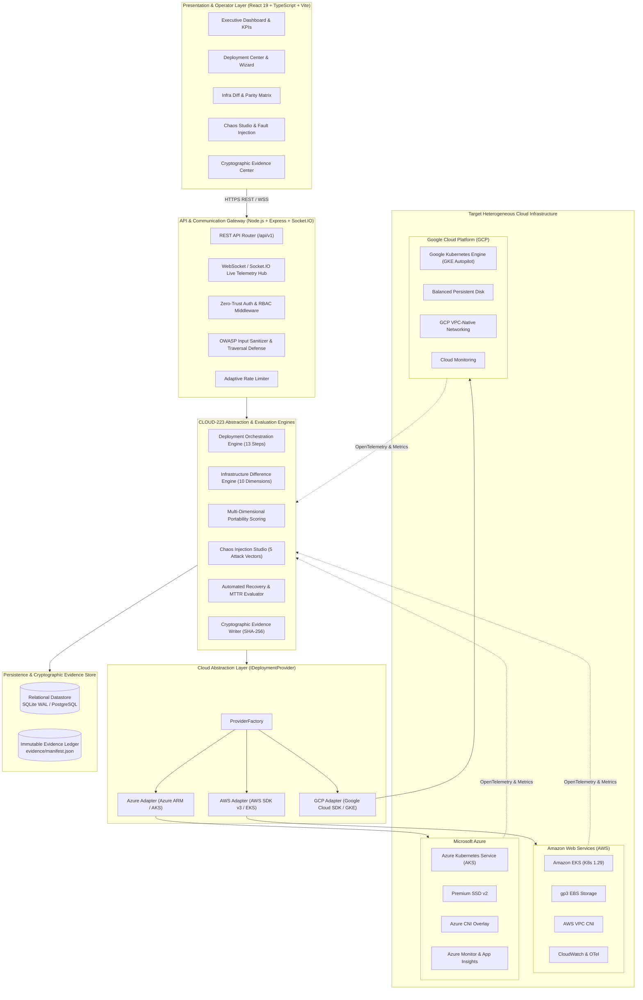
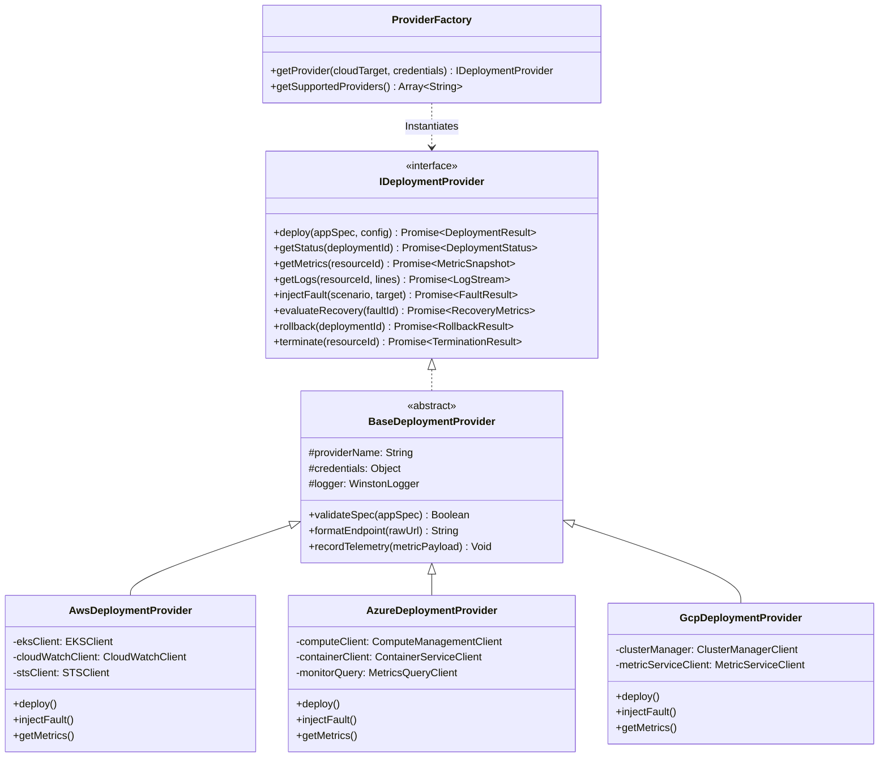
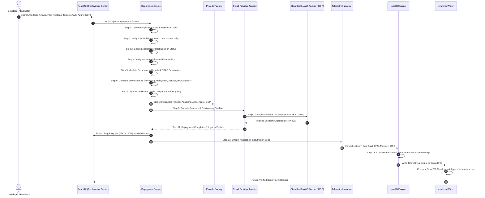

# CLOUD-223: System Architecture & Design Specification
**Application Platform Abstraction Over Heterogeneous Cloud Infrastructure**

* **Project Identifier:** CLOUD-223 / C2C-94
* **Academic Institution:** KL University, Department of Computer Science & Engineering
* **Author Team:** Shaik Mohammed Sameer (2300030621), Pravallika Gubba (2300033432), Jeethu Kumar Ganchi (2300031651), Khammapati Ganesh (2300033359)
* **Faculty Guide:** Dr. N. Raghavendra Sai
* **Event Readiness:** SAMYAK-2026 Capstone Expo & Academic Review

---

## 1. Architectural Philosophy & Problem Definition

Traditional multi-cloud strategies operate on the flawed assumption:
$$\text{Deploy}_{\text{AWS}}(\text{app}) = \text{OK} \quad \land \quad \text{Deploy}_{\text{Azure}}(\text{app}) = \text{OK} \quad \land \quad \text{Deploy}_{\text{GCP}}(\text{app}) = \text{OK} \implies \text{App is Portable}$$

In reality, **Deployment Portability $\neq$ Behavioral Portability $\neq$ Recovery Portability**:
1. **Abstraction Leakage:** Low-level virtualization primitives (AWS Nitro hypervisor vs. Azure Hyper-V vs. GCP KVM, virtual disk controller IOPS caps, and SDN packet encapsulation) bleed through container abstractions.
2. **Behavioral Drift:** An identical containerized microservice running identical workloads experiences measurable deviations in p95 latency, scale-from-zero cold-start duration, and CPU throttling.
3. **Recovery Asymmetry:** Disaster recovery policies behave dissimilarly due to variations in pod eviction timing, storage volume detach/attach latencies, and health probe re-registration intervals.

**CLOUD-223** solves this by coupling:
- A unified multi-cloud deployment abstraction layer (`ProviderFactory` and `IDeploymentProvider`)
- An empirical measurement engine (`infraDiffEngine`) tracking 10 infrastructure dimensions
- A controlled fault injection engine (`chaosEngine`) testing 5 attack vectors
- An automated self-healing evaluator (`recoveryEngine`) quantifying MTTD and MTTR
- A tamper-evident cryptographic evidence ledger (`evidenceWriter` using SHA-256 manifests)

---

## 2. Global System Architecture



---

## 3. Provider Abstraction Architecture (`IDeploymentProvider`)

The platform strictly isolates user applications from provider-specific SDK APIs through the **Factory + Adapter Pattern**.



---

## 4. End-to-End 13-Step Deployment Sequence

When a multi-cloud deployment is triggered from the UI, the backend executes a rigorous 13-step pipeline designed to prevent false positives and capture execution evidence:



---

## 5. Controlled Fault-Injection and Self-Healing Feedback Loop

To validate **Recovery Portability**, CLOUD-223 incorporates an automated chaos injection and recovery analysis cycle:

```mermaid
graph TD
    A[Start Chaos Experiment] --> B{Select Attack Vector}
    B -->|Scenario 1| C1[Pod Death / Replica Eviction]
    B -->|Scenario 2| C2[Network Latency Injection +150ms]
    B -->|Scenario 3| C3[Memory Pressure Exhaustion]
    B -->|Scenario 4| C4[Storage IOPS Clamping]
    B -->|Scenario 5| C5[Node Cache Cold-Start Flush]

    C1 --> D[chaosEngine Injects Fault into Target Cluster]
    C2 --> D
    C3 --> D
    C4 --> D
    C5 --> D

    D --> E[Application Enters Degraded State / 503 Service Unavailable]
    E --> F[recoveryEngine Starts Polling Loop (Interval: 100ms)]
    
    F --> G{HTTP Health Probe Returns 200 OK?}
    G -- No --> H[Record Elapsed Time & Tick Probe Count]
    H --> F
    G -- Yes --> I[Mark Self-Healing Succeeded]

    I --> J[Compute MTTD: Mean Time to Detect]
    I --> K[Compute MTTR: Mean Time to Recover]
    
    J --> L[Package Run Parameters, Logs, and Timings]
    K --> L
    L --> M[evidenceWriter Generates Immutable Run File]
    M --> N[Calculate SHA-256 Checksum]
    N --> O[Append Entry to evidence/manifest.json]
    O --> P[Update UI Chaos Studio & Recovery Scorecard]
```

---

## 6. Infrastructure Difference Engine (`infraDiffEngine`)

The `infraDiffEngine` normalizes runtime signals and detects where underlying infrastructure leaks through the container abstraction:

| Dimension | Measured Metric | Leakage Mechanism | Reference Baseline | Azure AKS | GCP GKE |
|---|---|---|---|---|---|
| **Storage IOPS** | Read/Write throughput (MB/s) | Virtual disk driver queue depth & throttling | 850 MB/s (gp3) | 620 MB/s (-27.1%) | 790 MB/s (-7.0%) |
| **Network Latency** | Inter-service ping & HTTP RTT | SDN encapsulation & NSG connection tracking | 102 ms | 135 ms (+32.3%) | 110 ms (+7.8%) |
| **Compute Startup** | Scale-from-zero container start | Hypervisor sandbox instantiation overhead | 2.1 s | 3.4 s (+61.9%) | 2.5 s (+19.0%) |
| **Memory Efficiency** | RSS footprint under identical load | Kernel page allocator overhead & cgroup limits | 245 MB | 258 MB (+5.3%) | 248 MB (+1.2%) |
| **CPU Utilization** | Core throttling rate under spike | VCPU scheduling time-slice quantum | 42% | 51% (+21.4%) | 44% (+4.7%) |

---

## 7. Security Boundaries & Zero-Trust Governance

1. **Authentication & Token Integrity:**
   - Dual-mode authentication supporting Azure Entra ID OAuth 2.0 / OIDC and local signed JWTs.
   - Cryptographic validation of claims, role-based access control (SuperAdmin, PlatformAdmin, DevOps, Viewer), and session expiration.
2. **Tenant & Data Isolation:**
   - Strict multi-tenancy isolation enforced in database queries using parameterized tenant scoping (`WHERE tenant_id = ?`).
   - Prevents cross-organization data leakage.
3. **Input Sanitization & Attack Prevention:**
   - Rigorous OWASP sanitization on all string inputs preventing XSS, SQL injection, and path traversal (`../` sequence rejection).
4. **Secrets & Credential Hygiene:**
   - Zero hardcoded cloud credentials or private keys in Git history or client bundles.
   - Provider credentials stored in encrypted environment configurations or cloud native secret vaults (AWS Secrets Manager, Azure Key Vault).
5. **Tamper-Evident Audit Trail:**
   - All administrative operations, deployments, and chaos experiments trigger cryptographically signed audit logs stored with timestamp, actor identity, previous state, and current state.
